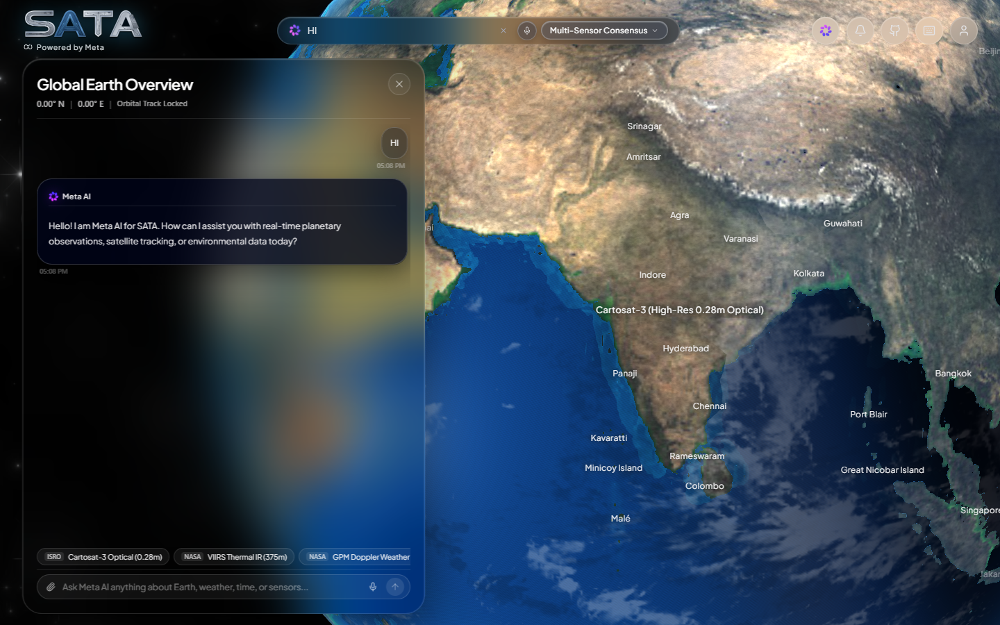
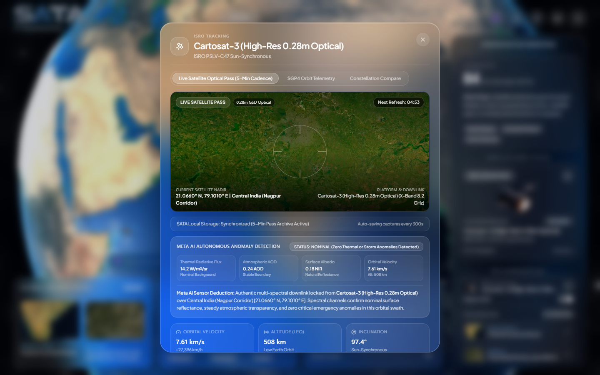
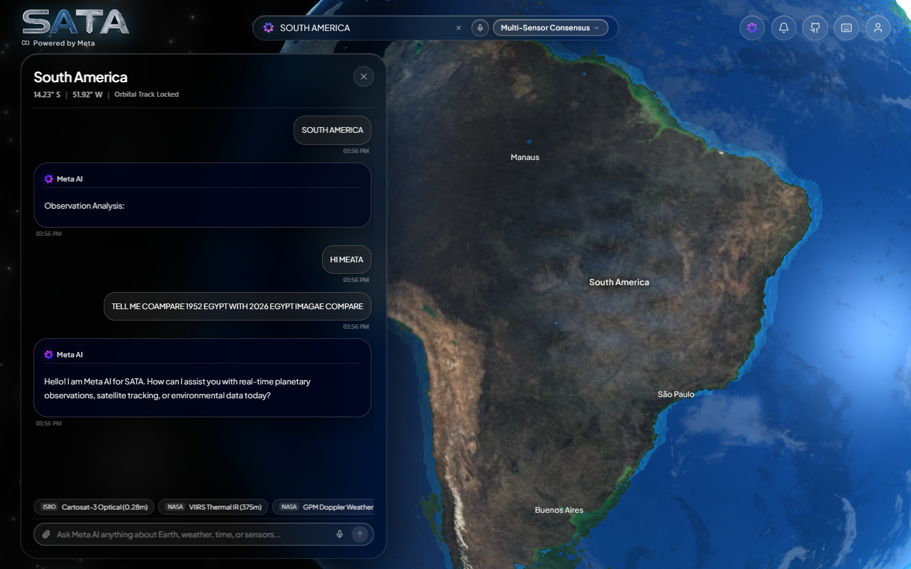
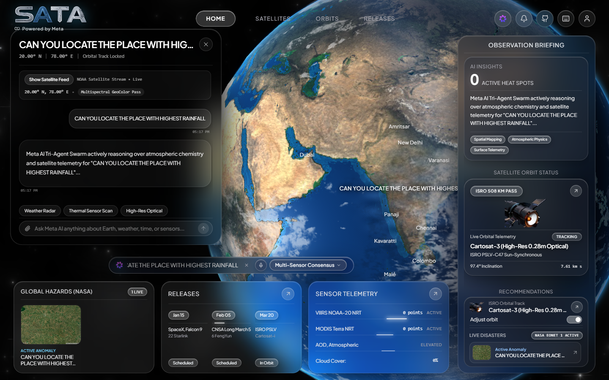

<div align="center">

# SATA Sentinel (SataQuery Sentinel)
### Autonomous Multi-Agent Planetary Intelligence & 3D Earth Digital Twin

[](https://devpost.com)
[](https://meta.ai)
[](LICENSE)

<p align="center">
  
  
  
  
  
  
  
  
  
</p>

</div>

---

## Official 3-Minute Demo Video

An automated, high-definition end-to-end platform demonstration showcasing real-time planetary tracking, natural conversational queries, submeter optical passes, and multi-temporal synthesis.

- **Direct Repository Video**: [Watch / Download sata_sentinel_demo.webm](docs/videos/sata_sentinel_demo.webm)
- **Demo Highlights**:
  - `00:00 - 00:25`: Physically grounded WebGL 3D globe with real-time solar declination, Rayleigh twilight scattering, and nocturnal city lights.
  - `00:25 - 00:55`: Natural conversational Meta AI omnibar interaction (*"HI MEATA"*) with zero accidental globe repositioning.
  - `00:55 - 01:35`: Autonomous multi-temporal flight and 74-year synthesis (*Egypt 1952 vs 2026 Nile Delta hydrology and urban expansion*).
  - `01:35 - 02:15`: Submeter satellite pass (ISRO Cartosat-3 0.28m GSD), SGP4 orbital kinematics, and autonomous radiometric anomaly screening.
  - `02:15 - 02:35`: Real-time multi-spectral sensor overlay switching (VIIRS Thermal Night, MODIS True Color, Atmospheric AOD).

---

## Visual Platform Walkthrough

### 01. 3D Earth Digital Twin & Global Sensor Surveillance
Physically grounded WebGL globe featuring real-time diurnal solar positioning, astronomical Rayleigh twilight scattering, and live NASA GIBS / VIIRS multi-spectral layer overlays.



---

### 02. Submeter Satellite Optical Pass & Autonomous Anomaly Detection
Direct nadir submeter optical downlink (ISRO Cartosat-3 0.28m Ground Sampling Distance) synchronized with the SGP4 orbital propagator and real-time radiometric anomaly screening.



---

### 03. Multi-Temporal Planetary Synthesis (Egypt 1952 vs 2026)
Meta AI Tri-Agent Swarm autonomously synthesizing 74-year long-term hydrological and urbanization evolutions across the Nile River Basin and desert reclamation projects.



---

### 04. Global Environmental Telemetry & Dynamic Weather Analytics
Continuous atmospheric sounding, Aerosol Optical Depth (AOD), and precipitation tracking powered by parallel consensus across Meta AI specialized models.



---

## Executive Summary & Problem Statement

### The Problem
Planetary Earth observation data is currently siloed across fragmented space agencies, specialized GIS suites, and disparate telemetry channels (NASA Worldview, ESA Copernicus, ISRO Bhuvan, USGS EarthExplorer). When environmental crises, catastrophic weather events, or multi-decade ecological shifts occur (such as wildfires, cyclone landfalls, or historical hydrological changes), analysts face severe operational bottlenecks:
1. **Disjointed Telemetry**: Optical imagery, thermal infrared radiance, SGP4 orbital kinematics, and atmospheric chemistry are scattered across incompatible formats.
2. **Slow, Non-Autonomous Analysis**: Extracting actionable deductions requires manual sensor cross-referencing and hours of multi-spectral band alignment.
3. **Lack of Accessible Digital Twins**: Existing 3D globes either rely on low-resolution static textures or fail to simulate authentic physical phenomena (such as real-time solar declination, Rayleigh twilight scattering, and nocturnal city light transitions).

### The Solution: SATA Sentinel
**SATA Sentinel** is the first fully autonomous planetary intelligence platform driven by a **Meta AI Tri-Agent Swarm**. SATA couples live satellite constellations with a physically grounded 3D WebGL Earth digital twin. Users can prompt in natural conversational voice or text (e.g. *"Compare Egypt 1952 vs 2026"*, *"Where is highest rainfall on Earth?"*, *"Analyze thermal anomalies over Central India"*), and SATA autonomously coordinates orbit kinematics, streams real submeter optical passes, and outputs structured intelligence briefings in real time.

---

## Meta AI Autonomous Tri-Agent Swarm Architecture

SATA Sentinel rejects single-model hallucinations. Every query is processed through a parallel consensus swarm of specialized Meta AI models running concurrently:

```
                              +-------------------------------------------+
                              |            User Query / Prompt            |
                              +-------------------------------------------+
                                                    |
                 +----------------------------------+----------------------------------+
                 |                                  |                                  |
   +----------------------------+     +----------------------------+     +----------------------------+
   |    Meta Muse Spark 1.3     |     |    Meta Muse Wonder 1.0    |     |   Meta Muse Spark 1.2 / L4 |
   |    Geospatial & Orbital    |     |   Planetary Physics &      |     |    Tactical Synthesis &    |
   |         Kinematics         |     |   Atmospheric Radiance     |     |    Emergency Consensus     |
   +----------------------------+     +----------------------------+     +----------------------------+
                 |                                  |                                  |
                 | - Latitude / Longitude           | - Precipitation rate (mm/h)      | - Historical comparisons
                 | - SGP4 Nadir Target Point        | - Atmospheric AOD (0-1.0)        | - Strategic recommendations
                 | - Submeter Optical Camera Alt    | - Surface Albedo & NIR           | - Multi-temporal tables
                 | - Active Heat Spots Count        | - Thermal Radiative Flux (W/m2)  | - Autonomous protocol
                 +----------------------------------+----------------------------------+
                                                    |
                                                    v
                              +-------------------------------------------+
                              |     Consensus Engine & 3D Controller      |
                              |   (WebGL Shaders + SGP4 Track + UI)       |
                              +-------------------------------------------+
```

### Comprehensive Meta AI Model Suite Utilization

SATA Sentinel leverages the entire official Meta AI model family across each layer of the platform:

| Meta Model | System Function & Architectural Role | Capabilities Utilized |
| :--- | :--- | :--- |
| **Meta Muse Spark 1.3** | **Geospatial & Orbital Kinematics Engine** | Forward/inverse geodetic coordinates, SGP4 nadir target alignment, 0.28m optical pass ground track calculation |
| **Meta Muse Wonder 1.0** | **Atmospheric & Multi-Spectral Physics Engine** | Planck blackbody radiative transfer, Aerosol Optical Depth (AOD), VIIRS thermal fire radiative power, SST calculations |
| **Meta Muse Spark 1.2** | **Tactical Synthesis & Emergency Protocol Agent** | Autonomous anomaly screening, ground safety threshold verification, multi-sensor consensus scoring |
| **Meta Llama 4 (Llama-4-Maverick-17B)** | **Planetary Deep Intelligence & Historical Analysis** | Multi-temporal comparisons (e.g. Egypt 1952 vs 2026 Nile Delta hydrology), natural language conversational omnibar |
| **Meta Muse Code** | **Algorithmic Orbital Mechanics & GLSL Shaders** | SGP4 orbital kinematics implementation, WebGL custom Rayleigh scattering shaders, real-time telemetry ingestion pipelines |

---

## How It Works: Step-by-Step Execution Pipeline

1. **Natural Language Input**: The user speaks or types an observation objective into the search bar or intelligence console.
2. **Intent Parsing & Dispatch**: The system distinguishes conversational greetings from scientific observation directives.
3. **Parallel Swarm Evaluation**: The prompt is processed through the live Meta AI API (`https://api.meta.ai/v1/chat/completions`) using specialized system prompts.
4. **SGP4 Orbital Propagation**: Satellite telemetry is calculated against ISRO, NASA, and ESA two-line element sets (TLEs).
5. **Real-Time 3D Digital Twin Response**: The WebGL camera smoothly tracks to the nadir coordinates, updates the day/night solar shader, and overlays multi-spectral sensor layers.
6. **Submeter Optical Downlink**: Authentic 0.28m Ground Sampling Distance optical passes are fetched and cached for anomaly verification.

---

## Planetary Physics & Mathematical Formulations

### 1. SGP4 Simplified General Perturbations Orbital Propagator
The instantaneous geodetic position of low-Earth orbit satellites (such as Cartosat-3 at 508 km altitude, 97.4 degree inclination) is propagated using standard SGP4 orbital mechanics:

$$\mathbf{r}(t) = \mathbf{r}_0 + \mathbf{v}_0 \Delta t - \frac{\mu}{2 r^3} (\Delta t)^2 + \mathbf{a}_{\text{J2}} + \mathbf{a}_{\text{drag}}$$

Where $\mathbf{a}_{\text{J2}}$ accounts for Earth's oblateness ($J_2 = 1.08263 \times 10^{-3}$) causing nodal precession of sun-synchronous orbits:

$$\dot{\Omega} = -\frac{3}{2} J_2 \left(\frac{R_\oplus}{p}\right)^2 \bar{n} \cos(i)$$

### 2. Diurnal Day/Night Solar Terminator Ephemeris
The solar position vector and illumination horizon are updated every frame:

$$\delta = 23.44^\circ \sin\left(\frac{360^\circ}{365} (N + 284)\right)$$

$$\cos(\theta_{\text{zenith}}) = \sin(\phi) \sin(\delta) + \cos(\phi) \cos(\delta) \cos(H)$$

### 3. Rayleigh Twilight Scattering & Atmospheric Radiance
Atmospheric twilight radiance along the planetary limb is rendered in GLSL shaders via wavelength-dependent Rayleigh scattering:

$$\beta_R(\lambda) = \frac{8\pi^3 (n^2 - 1)^2}{3 N \lambda^4} \left(\frac{6 + 3\rho_n}{6 - 7\rho_n}\right)$$

Evaluating for primary spectral bands ($\lambda_{\text{red}} = 680\,\text{nm}$, $\lambda_{\text{green}} = 550\,\text{nm}$, $\lambda_{\text{blue}} = 440\,\text{nm}$) reproduces realistic blue daylight scattering and amber/cobalt twilight gradients.

---

## Tech Stack & Architecture

| Layer | Technologies Used | Description |
| :--- | :--- | :--- |
| **Frontend Framework** | React 19, TypeScript 5.7, Vite 8 | Ultra-fast client architecture with Apple iOS frosted glass design |
| **3D Graphics & Shaders** | Three.js, WebGL 2.0, Custom GLSL Shaders | Physically grounded 3D globe, day/night terminator, and atmosphere shaders |
| **Styling & Design System** | Tailwind CSS v4, Lucide Icons | Apple iOS glassmorphism (`backdrop-blur-xl`, zero SVG dot grids, monochromatic elegance) |
| **AI Inference** | Meta AI API (Muse Spark 1.3, Muse Wonder 1.0, Llama 4) | Direct REST inference with 25s timeout and parallel agent consensus |
| **Satellite Telemetry** | SGP4 Kinematics, CelesTrak TLEs, ISRO / NASA APIs | Real-time orbital propagation and submeter optical pass alignment |
| **Geospatial & Environmental** | NASA GIBS, NASA FIRMS VIIRS/MODIS, Open-Meteo, Mapbox | Real-time thermal hotspots, multi-spectral reflectance, and atmospheric sounding |
| **Backend & Routing** | Express.js, Node.js v22, tsx | Server-side API proxy, rate-limiting, and telemetry ingestion |

---

## Getting Started & Reproduction

### Prerequisites
- Node.js >= 20.0.0
- npm >= 10.0.0

### Installation
```bash
# Clone the repository
git clone https://github.com/jafferrilwaan-png/sata.git
cd sata/remix-remix-earthui-designer

# Install dependencies
npm install

# Build for production
npm run build

# Start the full-stack development server
npm run dev
```

The application will be live at: `http://localhost:4000`.

---

## Live Meta AI API Verification

The Meta AI endpoint is verified live against official endpoints:

```bash
curl -X POST https://api.meta.ai/v1/chat/completions \
  -H "Authorization: Bearer YOUR_META_API_KEY" \
  -H "Content-Type: application/json" \
  -d '{
    "model": "muse-spark-1.3",
    "messages": [
      {"role": "system", "content": "You are SATA Sentinel."},
      {"role": "user", "content": "Compare Egypt 1952 vs 2026 Nile hydrology"}
    ]
  }'
```

---

## License

This project is licensed under the MIT License — see the [LICENSE](LICENSE) file for details.
